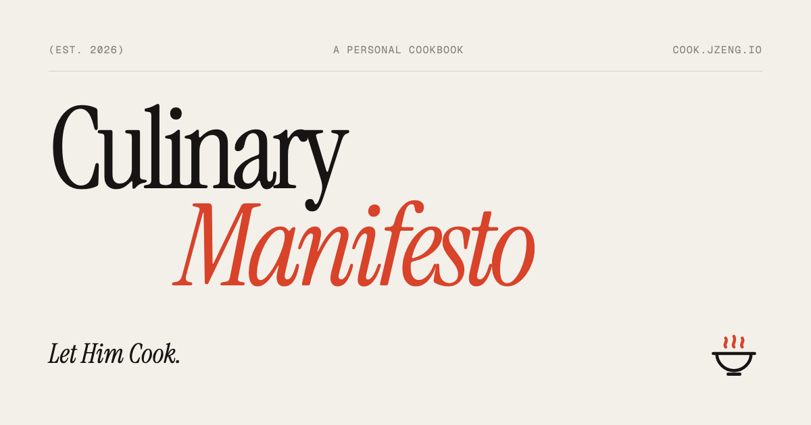

<p align="center"></p>
<h1 align="center">Culinary Manifesto</h1>
<p align="center"><i>Let Him Cook.</i><br>My cookbook, live at <a href="https://cook.jzeng.io">cook.jzeng.io</a>.</p>



A static site (plain HTML, CSS and JavaScript, no build step):

| Page | What's on it |
|---|---|
| **Home** (`#/`) | The title, the epigraph, the latest recipes and what's up next |
| **Cookbook** (`#/cookbook`) | Every recipe I've cooked: search, category filters, sort, drafts underneath, one page per recipe |
| **Manifesting** (`#/manifesting`) | Dishes I want to cook, by priority. Check one off and it's *manifested* |
| **Notebook** (`#/notebook`) | My kitchen wishlist (tools, pantry) and notes |
| **Tools** (`#/tools`) | Unit converter, cups ⇄ grams, servings scaler, pan-size scaler, oven chart, timer |

## On a recipe page
- **Tap any ingredient or step to check it off.** Checks are saved in that browser, so you can close the tab mid-recipe and pick up where you left off. Each person on their own phone gets their own checklist.
- **Scale** the batch (¼× to 8×, or by servings if the recipe sets `serves`). Amounts re-read as kitchen fractions and pick a sensible unit, so ¾ cup at ½× becomes **6 tbsp**.
- **Units:** Original, Metric (cups → ml, sticks → g, °F → °C) or US.
- **Timers:** any time in a step ("50 - 55 minutes", "an hour") is a button that starts a timer. Timers stay in the corner across pages and chime when done.
- **Cook mode:** bigger text, highlights the current step, scrolls to the next one as you check them off, and keeps the screen awake.
- **Chinese terms** like 当归 or 爆炒 are tappable for pinyin and English (or show English inline; see Settings).
- Share and print (the print view is just the recipe).

**Settings** (gear icon): theme (Auto / Light / Dark / **Night**, a warm, dim palette for late cooking), text size, motion, units, translations, screen wake, timer chime, and backup export/import.

## Adding things

Everything lives in `data/`. Edit, commit, push, and it's live.

**A recipe:** copy an entry in [`data/recipes.js`](data/recipes.js). The field list is at the top of the file.
```js
{
    slug: "scallion-pancakes",          // the URL: cook.jzeng.io/#/r/scallion-pancakes
    title: "葱油饼",
    py: "cōngyóubǐng",
    en: "Scallion pancakes",
    category: "Buns & dumplings",
    tags: ["vegetarian", "pan-fried"],
    serves: 4,                          // optional: scaler counts servings
    photo: "assets/photos/scallion-pancakes.jpg", // optional
    sections: [
        { title: "Dough", kind: "ingredients", items: ["2 cups flour", "¾ cup hot water", { text: "1 tsp salt", check: true }] },
        { title: "Steps", kind: "steps", items: ["Rest the dough for 30 minutes.", "Fry at medium heat, 3 minutes a side."] },
    ],
},
```
- Amounts at the **start** of an ingredient scale and convert: `2 cups`, `¼ - ½ tsp`, `1.5 sticks`, `20 g`, `1 1/2 cups`.
- `check: true` flags an amount I haven't confirmed yet. `note:` adds a small grey note, and `en:` adds English for a Chinese ingredient.
- `status: "draft"` shows a Draft badge while steps or amounts are missing.
- New Chinese terms go in [`data/glossary.js`](data/glossary.js).

**A dish to manifest:** add a line to [`data/manifesting.js`](data/manifesting.js) with `priority: "critical" | "high" | "medium" | "low"`. Once it's cooked, add `done: "YYYY-MM-DD"` (or `recipe: "<slug>"` once it's written up, which also links to it) and it moves to *Manifested*.

**Wishlist items and notes:** [`data/notebook.js`](data/notebook.js). Add `got: "YYYY-MM-DD"` to tick off a wishlist item for good.

**Adding from the site:** the + buttons and checkboxes on Manifesting and Notebook save **only in that browser**. The site can't write to this repo, so nothing a visitor adds changes what anyone else sees. To make my own entries permanent:
1. On the device I added them on: **Settings → Export backup** (or **Copy as data** on the page).
2. Merge the entries into the data files, then commit and push.
3. Once an entry is in the data file, the browser's own copy is dropped automatically, so nothing shows twice.

Safari can clear a site's saved data after about a week without a visit, so merge regularly. Adding the site to the Home Screen keeps it.

## Run it locally
```bash
python3 -m http.server 8000      # then open http://localhost:8000
node tests/run.js                # amount parsing, scaling, conversions, data checks
open http://localhost:8000/tests/ui.html   # clicks through the real app (checks, scaler, timers, lists, settings)
```

## Deploying (GitHub Pages)
1. **Settings → Pages → Build and deployment:** Source **Deploy from a branch**, branch **`main`**, folder **`/ (root)`**.
2. DNS: a `CNAME` record for **`cook`** pointing to **`whoisjoshua.github.io`**. The [`CNAME`](CNAME) file already says `cook.jzeng.io`.
3. Once the certificate is issued, tick **Enforce HTTPS**.

The site works offline after the first visit (`sw.js`, network first, so new pushes show up right away). Bump `VERSION` in `sw.js` if you ever want to drop the old cache.

## Structure
```
index.html             shell (header, tab bar, dialogs)
css/styles.css         design system: tokens, light/dark/night, layout, motion, print
data/*.js              the content: site text, recipes, glossary, manifesting, notebook
js/quantity.js         amounts, units, fractions, temperatures, times (pure; tested in Node)
js/core.js             storage, settings, icons, logo, rich text, plates, toasts, glossary popover
js/timers.js           kitchen timers dock
js/views/*.js          one file per page
js/app.js              router, transitions, settings sheet, backups, footer
assets/                logo, favicon, app icons, social image (put recipe photos in assets/photos/)
tests/                 run.js (Node) and ui.html (browser)
```
